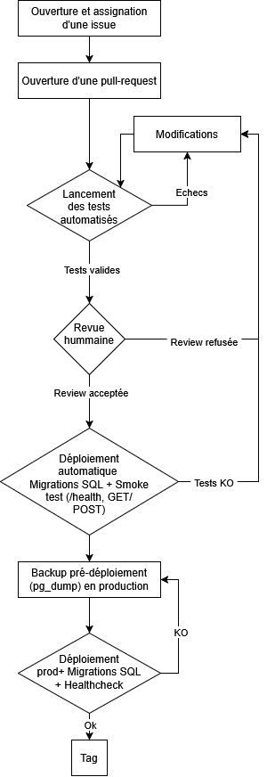

# Guide de pipeline

## Schéma de la pipeline

## Tableau des déclancheurs

| Étape | Déclencheur | Durée estimée | Bloquante ? | Justification / Risque couvert |
| :--- | :--- | :--- | :--- | :--- |
| **Ouverture et assignation d'une issue** | Nouveau besoin / tâche / anomalie | ~5 min | Oui | Assure la traçabilité écrite et asynchrone du travail (équipe distribuée, 1h commune max/jour). |
| **Ouverture d'une pull-request** | Création de branche et premier push | ~5 min | Oui | Impose le passage par PR plutôt que le push direct sur la branche principale, avec contexte clair. |
| **Lancement des tests automatisés** | Ouverture / mise à jour de la PR (`Modifications`) | ~2 – 4 min | Oui (`Echecs` -> `Modifications`) | Détecte les régressions avant revue ou déploiement ; compense le réseau instable à la montagne via l'exécution en CI. |
| **Revue humaine** | Tests automatisés validés | Variable (SLA 12h max) | Oui (`Review refusée` -> `Modifications`) | Valide la qualité et la conformité du code sans bloquer les fuseaux horaires (avec bypass tracé si urgence). |
| **Déploiement automatique (Migrations SQL + Smoke test `/health`, `GET`/`POST`)** | Revue acceptée | ~2 – 3 min | Oui (`Tests KO` -> `Modifications`) | Vérifie les migrations SQL et le comportement réel du service (`/health`, `GET`/`POST`) de manière automatisée sans action manuelle. |
| **Backup pré-déploiement (`pg_dump`) en production** | Smoke test validé | ~1 – 2 min | Oui | Sécurise l'état des données en production avant l'exécution des migrations et du déploiement prod. |
| **Déploiement prod + Migrations SQL + Healthcheck** | Backup `pg_dump` terminé | ~1 – 2 min | Oui (`KO` -> retour arrière / reprise ; `Ok` -> `Tag`) | Déploie la nouvelle version en production avec contrôle d'intégrité (`Healthcheck`) pour éviter les pannes prolongées. |
| **Tag** | Déploiement prod `Ok` | < 1 min | Non (post-déploiement) | Identifie formellement la version déployée en production afin de savoir immédiatement quelle version tourne et faciliter le retour arrière

## Procédure de retour arrière (Rollback)

### 1. Qui la déclenche ?
* **Déclenchement automatique (CI/CD)** : si le *healthcheck* échoue après le déploiement en production ou si une erreur critique apparaît dès le démarrage du nouveau conteneur.
* **Déclenchement humain (n'importe quel membre de l'équipe disponible)** : dès qu'une régression bloquante est constatée en production (ex. blocage des commandes, erreurs http `5xx` répétées, dégradation majeure après mise en ligne).
* **Décision & coordination** : pour éviter toute perte de temps liée aux fuseaux horaires (Antilles / Montagne) ou à la fenêtre commune limitée à 1h/jour, **tout membre qui constate un incident critique en production a le droit et le devoir de déclencher immédiatement le retour arrière**, sans attendre la réunion quotidienne.

### 2. Comment s'exécute-t-elle ?
* **Identification de la version cible** : on repère le tag / digest d'image précédent valide (ex. `vX.Y.Z-1` ou SHA précédent jamais `latest`) correspondant au dernier état sain connu en production.
* **Redéploiement rapide de l'image précédente** : on déploie immédiatement l'image Docker précédente via le pipeline/orchestrateur (ou commande de redéploiement ciblée sur le serveur/VPS) avec la configuration saine connue, sans reconstruire l'image de zéro.
* **Vérification du service** : contrôle immédiat de l'endpoint `/health` et d'un appel fonctionnel de base (`GET /products` / `POST /orders` selon le périmètre) pour confirmer le rétablissement.
* **Gestion de la base de données (Rétrocompatibilité & `pg_dump`)** :
  * Si la migration SQL a échoué partiellement ou corrompu des données critiques, on restaure le dump `pg_dump` généré juste avant le déploiement (en évaluant l'impact sur les données récentes).
* **Traçabilité post-action** : ouverture/mise à jour d'un incident dans `docs/incidents.md` (qui a déclenché, quand, cause, impact, règles éventuelles à ajuster) et création d'une branche `hotfix/*` ou `fix/*` pour corriger proprement.

### 3. En combien de temps ?
* **Objectif cible : moins de 5 minutes** entre la détection de la défaillance et le rétablissement d'une version fonctionnelle en production.
* **Répartition indicative** :
  * Détection & décision de rollback : **< 1 min**
  * Redéploiement de l'image précédente (pull/switch conteneur) : **1 – 2 min**
  * Vérification `/health` et smoke test minimal : **< 1 min**

### 4. Ce qu'elle ne sait pas annuler
* **Les écritures métier enregistrées après le déploiement** : redéployer l'ancienne version applicative n'efface pas les lignes créées ou modifiées en base après la mise en ligne ; inversement, restaurer un `pg_dump` pré-déploiement efface toutes les écritures survenues depuis ce backup.
* **Les effets de bord externes déjà émis** : appels à des API tierces, notifications envoyées, paiements ou messages déjà transmis à des utilisateurs/prestataires.
* **Les secrets exposés ou compromis** : un retour arrière technique ne révoque pas une clé API ou un mot de passe qui aurait fuité.
* **Les impacts humains ou commerciaux déjà subis** : commandes manquées ou mécontentement client pendant la fenêtre d'incident