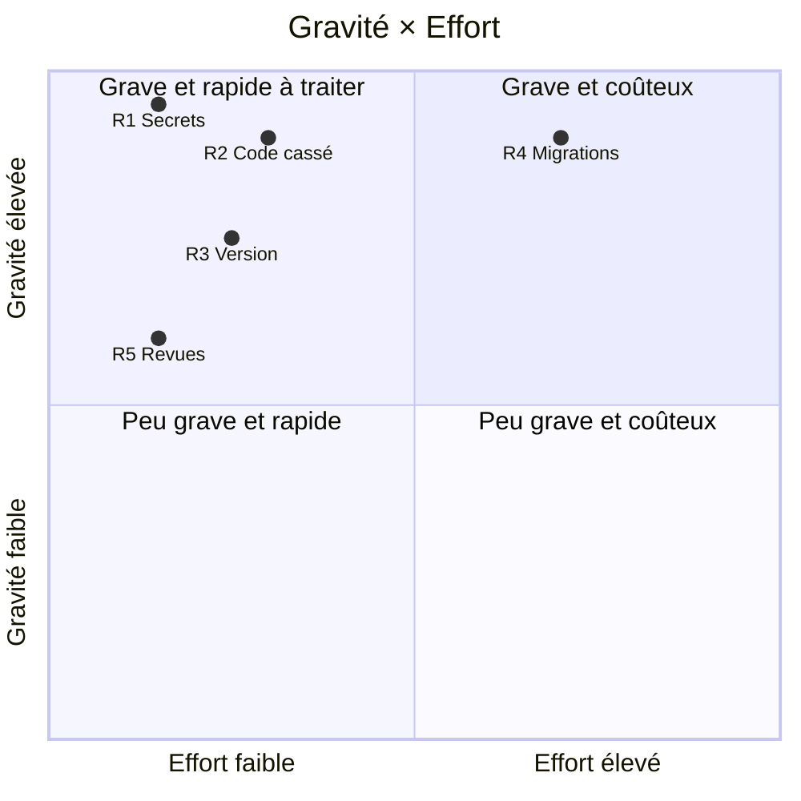

# T1 — Analyse des risques

## Sources de l'analyse

**Contexte de l'équipe (Carte tirée) :**
- Équipe réduite de 4 développeurs.
- Répartition géographique critique : 2 membres à la montagne (réseau instable), 1 membre aux Antilles (décalage horaire -5h/-6h), 1 membre à Brest.
- Fenêtre de synchronisation très limitée : 1 heure maximum par jour où toute l'équipe travaille simultanément.
- Contraintes parties prenantes : livraison rapide demandée par le PO, développeur freelance payé à l'heure réticent à l'attente, crainte de la Lead Dev d'un ralentissement lié aux revues.

**Anciennes pratiques** : 

- Tout le monde poussait directement sur la branche principale.
- Un workflow construisait l’image avec le tag latest et la déployait sans tests en SSH à chaque push.
- Les mots de passe et clés d’API étaient dans un fichier .env versionné.
- Les migrations de base étaient lancées sur le serveur quand on y pense.
- Les tests existaient à peine et personne ne les lançait

 **Incident d'août** : 

Un déploiement le vendredi à 19 h a bloqué les commandes pendant 14 h, et personne ne savait quelle version tournait.

---

## 1. Risques retenus

### R1 — Fuite de secrets

- **Origine** : le `.env` versionné de l'ancienne équipe et le dépôt **public** imposé par le TP.

- **Scénario de défaillance** : un développeur commit par erreur son `.env`, qui contient le mot de passe PostgreSQL ou une clé d'API. Le dépôt étant public, un bot récupère les accès en quelques minutes et vide ou chiffre la base de production. Supprimer le fichier ensuite ne règle rien : il reste dans l'historique Git. Du coup c'est grave !!!

- **Gravité** : **critique**. Fuite de données et arrêt total de la plateforme.
- **Mesure** :
  - `.env` est dans le `.gitignore`, et seul un `.env.example` sans valeurs réelles sera versionné
  - les secrets sont stockés uniquement dans **GitHub Secrets**
  - la *push protection* est activé

### R2 — Code cassé déployé en production
- **Origine** : le push direct sur la branche principale, le déploiement sans tests à chaque push et l'incident du vendredi 19 h. 
**Dans le cas de notre carte (D), ce rique peut être plus fréquent** : un développeur peut pousser à la hâte avant une coupure réseau ou avant la fin de sa journée décalée.

- **Scénario de défaillance** : le freelance, pressé, ou un membre en fin de journée pousse directement sur `main` une modification qui n'a été ni relue ni testée. Elle casse `POST /orders` et les commandes restent bloquées 14 h en pleine saison.

- **Gravité** : **critique**.

- **Mesure** :
  - `main` est verrouillée par un **ruleset GitHub** (déjà en place) et la pull request est obligatoire
  - les tests automatisés tournent dans **GitHub Actions** et constituent un check bloquant avant le merge
  - la mise en production demande l'**approbation** d'une personne désignée, configurée sur l'environnement GitHub

### R3 — Version en production introuvable et retour arrière trop lent (plus de 5 min)
- **Origine :** Les anciennes pratiques (image toujours taguée `:latest`, aucune traçabilité de ce qui tourne en production) et la contrainte de la partie 2 (retour arrière obligatoire en moins de 5 minutes).
- **Scénario de défaillance :** Après une mise en production, le service tombe ou se dégrade. Chaque build écrase le tag `:latest`, si bien que personne ne peut dire quel commit tourne et que l'image précédente n'existe plus. Il faut donc reconstruire l'ancienne version en urgence. C'est impossible si le développeur concerné est hors ligne à la montagne ou en pleine nuit aux Antilles.
- **Gravité :** **Élevée**. Ce risque ne provoque pas la panne, mais il en allonge fortement la durée.
- **Mesure de traitement :** 
Chaque image est taguée avec son numéro de version (`v1.2.0`) au lieu de `:latest`. 
On sait ainsi quelle version tourne en production, et l'ancienne image reste disponible : pour revenir en arrière, il suffit de redéployer la version précédente.

### R4 — Migration de base qui casse la production
- **Origine** : les migrations étaient lancées à la main sur le serveur « quand on y pense ». La user story *gestion du stock* va justement ajouter une colonne en base.
- **Scénario de défaillance** : on déploie la nouvelle version mais personne ne lance la migration. Le code cherche une colonne `stock` qui n'existe pas et toutes les commandes échouent. 
Autre cas : une migration supprime une colonne, et le retour à la version précédente devient impossible, car l'ancien code ne fonctionne plus avec le nouveau schéma.
- **Gravité** : **critique**. Les commandes sont bloquées et des données peuvent être perdues.
- **Mesure** : 
Les migrations sont des fichiers versionnés dans Git et lancées automatiquement par le pipeline à chaque déploiement : plus aucun oubli possible. 
On ne fait qu'ajouter des colonnes, on n'en supprime jamais, pour que la version précédente continue de fonctionner en cas de retour arrière.
### R5 — Revues de code bloquées et règles contournées
- **Origine** : **Notre carte (D)** (décalage horaire, réseau instable, une seule heure commune par jour) et les parties prenantes : la lead dev craint que les revues ralentissent tout, le freelance ne veut pas attendre et le PO veut livrer vite.
- **Scénario de défaillance** : 
une PR attend une journée entière parce que le relecteur dort aux Antilles ou n'a pas de réseau à la montagne. Pour avancer, l'équipe finit par valider sans lire ou par contourner la protection de `main`. Les règles ne servent plus à rien.
- **Gravité** : **moyenne à élevée**. Si les règles sont contournées, toutes les autres mesures tombent avec elles.
- **Mesure** : **un seul relecteur** par PR, et des **PR courtes** pour qu'elles se relisent vite. Chaque PR doit expliquer ce qu'elle fait et montrer que les tests passent, pour être relue sans attendre l'auteur. En cas d'urgence, la lead dev peut forcer le merge, à condition d'écrire dans la PR qui l'a fait et pourquoi.

---

## 2. Échelle gravité × effort

**Gravité** : critique > élevée > moyenne
**Effort** : faible (réglage GitHub ou règle écrite) · moyen (code ou pipeline à écrire)

| Risque | Gravité | Effort | Priorité |
|---|:---:|:---:|:---:|
| R1 — Fuite de secrets | Critique | Faible | **1** |
| R2 — Code cassé en production | Critique | Faible | **1** |
| R3 — Version introuvable / retour arrière lent | Élevée | Faible | **2** |
| R5 — Revues bloquées | Moyenne à élevée | Faible | **2** |
| R4 — Migration qui casse la production | Critique | Moyen | **3** |

## 3. Justification du positionnement

- **R1 et R2 sont traités en premier** : ils sont critiques et presque gratuits à corriger. Un `.gitignore`, GitHub Secrets, un ruleset et un job de test suffisent. R2 est la cause directe de l'incident d'août, et R1 ne se rattrape pas sur un dépôt public.
- **R3** est un peu moins grave : il ne provoque pas la panne, il la fait durer. Il est très simple à traiter (taguer les images avec un numéro de version) et doit être prêt avant la première mise en production, à cause de l'exigence de retour arrière en moins de 5 minutes.
- **R5** ne casse pas directement la production, mais **notre carte (D)** le rend inévitable : avec une seule heure commune par jour, des revues lentes pousseraient l'équipe à contourner les règles. Il ne coûte rien, ce ne sont que des règles d'organisation.
- **R4** est aussi grave que R1 et R2, mais c'est le seul qui demande un vrai travail : écrire des fichiers de migration et les lancer depuis le pipeline. On le traite après les autres, mais avant la partie 2, puisque la gestion du stock ajoute une colonne en base.